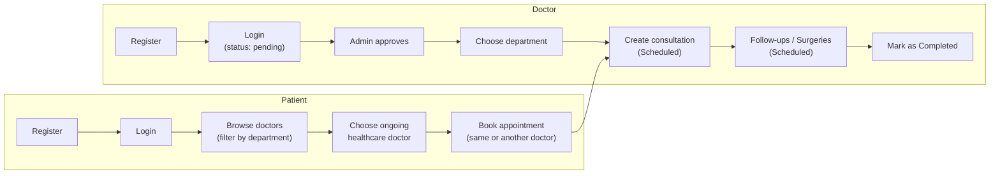
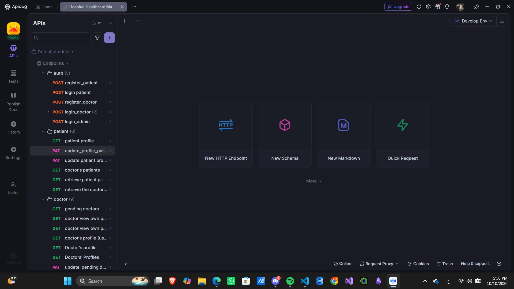
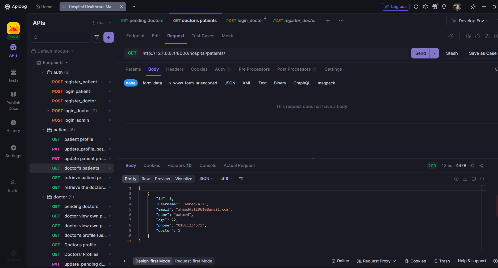
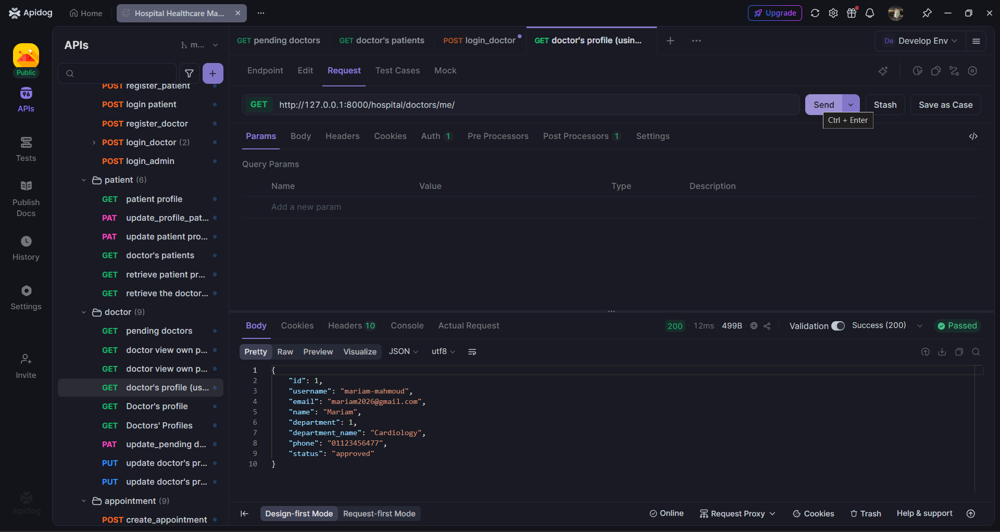
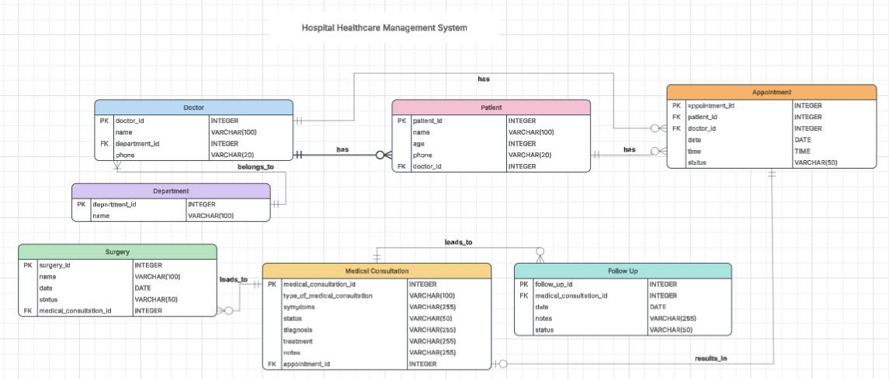

# Hospital Healthcare Management System

A RESTful backend API for the Hospital Healthcare Management System, a centralized platform for managing hospital operations: patients, doctors, departments, appointments, medical consultations, follow-ups, and surgeries. Built with Django and Django REST Framework, secured with JWT authentication and role-based permissions.

---

## Table of Contents

1. [Project Overview](#1-project-overview)
2. [Main Features](#2-main-features)
3. [Workflow](#3-workflow)
4. [Technologies Used](#4-technologies-used)
5. [Installation Instructions](#5-installation-instructions)
6. [Environment Variables](#6-environment-variables)
7. [How to Run](#7-how-to-run)
8. [API Documentation](#8-api-documentation)
9. [Database / ERD](#9-database--erd)
10. [Project Structure](#10-project-structure)
11. [Future Improvements](#11-future-improvements)
12. [Author](#12-author)

---

## 1. Project Overview

### What it does

The **Hospital Healthcare Management System** is a backend API that digitizes the core workflow of a hospital in one centralized platform. It handles patient and doctor registration, doctor approval, department management, appointment booking, medical consultations, follow-ups, and surgeries. Every user manages only the resources they need, according to their role and permissions.

### Problem it solves

Managing healthcare can be complicated for both patients and healthcare providers when there is no centralized system to organize the entire process.

- **For patients**, keeping track of doctors, appointments, consultations, follow-ups, surgeries, and medical records becomes difficult when this information is handled manually or spread across different systems.
- **For doctors**, there is a need for an organized way to manage appointments, access assigned patients, and maintain medical records throughout the treatment process.
- **For administrators**, there is a need for better control over doctors, patients, departments, and other healthcare operations.

This system connects patients, doctors, and administrators in one place and simplifies the healthcare workflow. The goal is to make healthcare management more organized, accessible, and easier for everyone involved.

### Intended users

| Role | What they can do |
|------|------------------|
| **Patient** | Manage their profile, find doctors, book and cancel appointments, and access their own medical records (consultations, follow-ups, and surgeries). |
| **Doctor** | Manage their profile and appointments (registration requires admin approval), access their assigned patients, and record consultations, follow-ups, and surgeries in an organized way. |
| **Admin** | Approve or reject doctors, and manage doctors, patients, departments, appointments, and overall healthcare operations. |

---

## 2. Main Features

- **JWT authentication**: login and token refresh using `djangorestframework-simplejwt`.
- **Role-based access control**: three roles (`Admin`, `Doctor`, `Patient`) with custom permission classes and role-filtered querysets.
- **Separate registration flows** for patients and doctors.
- **Doctor approval workflow**: new doctors start as `pending` and can only work after an admin sets them to `approved`.
- **Department management** (public read, admin-only write).
- **Doctor listing** with filtering by department, search by name, and ordering. Only approved doctors are listed publicly.
- **Appointment booking** with automatic patient assignment and validation that prevents double-booking a doctor for the same date and time.
- **Appointment actions**: `cancel` (patient, doctor, or admin) and `complete` (doctor or admin).
- **Medical consultations** linked one-to-one with appointments (diagnosis, treatment, notes).
- **Follow-ups and surgeries** linked to medical consultations.
- **Ownership validation**: a doctor can only create or update records for their own appointments.
- **Self-service profile endpoints** (`/me/`) for patients and doctors.
- **Django admin panel** with all models registered.

---

## 3. Workflow

### Overview



### Patient workflow

| Step | Action | Endpoint |
|------|--------|----------|
| 1 | **Register** as a patient. | `POST /user/register/patients/` |
| 2 | **Login** to get the JWT access and refresh tokens. | `POST /user/login/` |
| 3 | **View the available departments.** | `GET /hospital/departments/` |
| 4 | **Browse and filter doctors** by department (only approved doctors are listed). | `GET /hospital/doctors/?department=<department name>` |
| 5 | **Choose a doctor** to be their ongoing healthcare doctor. The doctor's ID is stored in the patient's record, and this doctor follows the patient's case from then on. | `PATCH /hospital/patients/me/` with `{"doctor": <doctor_id>}` |
| 6 | **Book an appointment** (a medical examination) with a doctor. This can be the same ongoing doctor or any other approved doctor. The patient is set automatically from the logged-in user, and the appointment starts as `Scheduled`. | `POST /hospital/appointments/` with `{"doctor": <doctor_id>, "date": "YYYY-MM-DD", "time": "HH:MM:SS"}` |
| 7 | **Cancel** an appointment if needed (completed appointments cannot be cancelled). | `PATCH /hospital/appointments/{id}/cancel/` |
| 8 | **View their own records**: appointments, consultations, follow-ups, and surgeries. | `GET /hospital/appointments/`, `/medical-consultations/`, `/follow-ups/`, `/surgeries/` |

> The ongoing healthcare doctor (step 5) and the doctor chosen for an appointment (step 6) are independent choices. A patient can see a different doctor for a specific examination while keeping the same ongoing doctor.

### Doctor workflow

| Step | Action | Endpoint |
|------|--------|----------|
| 1 | **Register** as a doctor. The account starts with status `pending`. | `POST /user/register/doctors/` |
| 2 | **Login** to get the JWT tokens. A pending doctor can log in and edit their profile but cannot manage medical records yet. | `POST /user/login/` |
| 3 | **Wait for admin approval.** Once the admin sets the status to `approved`, the doctor is listed publicly and gets full doctor permissions. | (done by the admin) |
| 4 | **Choose a department** from the list of available departments. The department ID is stored in the doctor's record. | `GET /hospital/departments/`, then `PATCH /hospital/doctors/me/` with `{"department": <department_id>}` |
| 5 | **View their appointments** and the patients assigned to them. | `GET /hospital/appointments/`, `GET /hospital/patients/` |
| 6 | **Create a medical consultation** for one of their appointments. It starts as `Scheduled`. | `POST /hospital/medical-consultations/` |
| 7 | **Create follow-ups and surgeries** linked to the consultation. They start as `Scheduled`. | `POST /hospital/follow-ups/`, `POST /hospital/surgeries/` |
| 8 | **Mark items as `Completed`** when they are finished. | See [Status lifecycle](#status-lifecycle) |

### Admin workflow

The admin has access to everything in the system and is responsible for:

1. **Approving or rejecting doctors:** list the pending doctors with `GET /hospital/doctors/pending_doctors/`, then update the status with `PATCH /hospital/doctors-admin/{id}/` and `{"status": "approved"}`. Only approved doctors can use their permissions.
2. **Managing departments:** create, update, and delete departments under `/hospital/departments/`.
3. **Managing patients, doctors, appointments, and all medical records** (consultations, follow-ups, and surgeries), including deleting records.

### Clinical flow

Once a patient books an appointment, the medical records are created in this order, and each step is linked to the previous one:

```
Appointment  →  Medical Consultation  →  Follow-up(s)
                                      →  Surgery / Surgeries
```

1. The **patient books an appointment** with a doctor (`Scheduled`).
2. The **doctor creates a medical consultation** for that appointment with the diagnosis, treatment, and notes (`Scheduled`). A doctor can only create a consultation for their own appointments.
3. The **doctor creates follow-ups and surgeries** for that consultation when needed (`Scheduled`).
4. Each item is marked `Completed` when it is finished.

Because every record is reached through the appointment, the patient and the doctor do not need to be sent again at each step.

### Status lifecycle

Appointments, consultations, follow-ups, and surgeries all share the same statuses and start as `Scheduled`.

```
            ┌──────────► Completed
Scheduled ──┤
            └──────────► Cancelled
```

| Item | How the status changes |
|------|------------------------|
| **Appointment** | `PATCH /hospital/appointments/{id}/complete/` (doctor or admin) or `PATCH /hospital/appointments/{id}/cancel/` (patient, doctor, or admin). A cancelled appointment cannot be completed, and a completed appointment cannot be cancelled. |
| **Medical consultation** | `PATCH /hospital/medical-consultations/{id}/` with `{"status": "Completed"}` (doctor or admin). |
| **Follow-up** | `PATCH /hospital/follow-ups/{id}/` with `{"status": "Completed"}` (doctor or admin). |
| **Surgery** | `PATCH /hospital/surgeries/{id}/` with `{"status": "Completed"}` (doctor or admin). |

---

## 4. Technologies Used

| Technology | Purpose |
|------------|---------|
| **Python 3.14** | Programming language |
| **Django 6.1** | Web framework |
| **Django REST Framework** | REST API toolkit |
| **djangorestframework-simplejwt** | JWT authentication |
| **django-filter** | Filtering on list endpoints |
| **python-dotenv** | Loading environment variables from `.env` |
| **SQLite** | Database (Django default, no extra setup required) |
| **uv** | Dependency and virtual environment manager |
| **Apidog** | API documentation |
| **Lucidchart** | ERD design |

---

## 5. Installation Instructions

### Prerequisites

- Python **3.14** or newer
- [uv](https://docs.astral.sh/uv/) (recommended) or `pip`
- Git

### Steps

**1. Clone the repository**

```bash
git clone https://github.com/Ahmedali1910/Hospital-Healthcare-Management-System.git
cd Hospital-Healthcare-Management-System
```

**2. Install dependencies**

Using `uv` (recommended, uses `pyproject.toml` and `uv.lock`):

```bash
uv sync
```

Or using `pip`:

```bash
python -m venv .venv

# Windows
.venv\Scripts\activate
# macOS / Linux
source .venv/bin/activate

pip install "django>=6.1.1" "django-filter>=26.1" "djangorestframework>=3.18.1" "djangorestframework-simplejwt>=5.5.1" "python-dotenv>=1.2.4"
```

**3. Configure the environment**

The `.env` file is **not** included in the repository (it is git-ignored because it contains secrets), so you need to create your own local copy from the provided template:

```bash
cp .env.example .env
```

Then set your own values (see [Environment Variables](#6-environment-variables)).

**4. Set up the database**

The project uses **SQLite**, so no database setup is needed. The database file (`db.sqlite3`) is created automatically when you run the migrations in the next step.

**5. Run migrations**

```bash
uv run python manage.py makemigrations
uv run python manage.py migrate
```

**6. Create an admin account**

```bash
uv run python manage.py createsuperuser
```

> Accounts created with `createsuperuser` get the default role `Patient`. Open the Django admin at `/admin/` and change the user's **role** to `Admin` so the API recognizes them as an admin.

**7. Start the server**

```bash
uv run python manage.py runserver
```

The API is now available at `http://127.0.0.1:8000/`.

---

## 6. Environment Variables

Create a `.env` file in the project root (next to `manage.py`) using `.env.example` as a template. **Never commit the real `.env` file**; it is already listed in `.gitignore`, and only `.env.example` (with no real values) is tracked.

| Variable | Required | Description | Example |
|----------|----------|-------------|---------|
| `SECRET_KEY` | Yes | Django secret key used for cryptographic signing. | `your-secret-key-here` |
| `DEBUG` | Yes | Set to `True` for development. Any other value is treated as `False`. | `True` |

Example `.env.example`:

```env
SECRET_KEY=your-secret-key-here
DEBUG=True
```

To generate a secret key:

```bash
python -c "from django.core.management.utils import get_random_secret_key; print(get_random_secret_key())"
```

---

## 7. How to Run

```bash
# 1. Activate the environment (only needed if you are not using `uv run`)
source .venv/bin/activate        # Windows: .venv\Scripts\activate

# 2. Create and apply migrations
python manage.py makemigrations
python manage.py migrate

# 3. Start the development server
python manage.py runserver
```

Then:

- API root: `http://127.0.0.1:8000/`
- Django admin: `http://127.0.0.1:8000/admin/`

### Authentication

After logging in, send the access token with every protected request:

```
Authorization: Bearer <access_token>
```

See the [Workflow](#3-workflow) section for the full step-by-step flow for patients, doctors, and admins.

### Main endpoints

**Authentication** (prefix `/user/`)

| Method | Endpoint | Description | Access |
|--------|----------|-------------|--------|
| POST | `/user/register/patients/` | Register a patient | Public |
| POST | `/user/register/doctors/` | Register a doctor (starts as `pending`) | Public |
| POST | `/user/login/` | Obtain access and refresh tokens | Public |
| POST | `/user/token/refresh/` | Refresh the access token | Public |

**Hospital** (prefix `/hospital/`)

| Resource | Endpoint | Notes |
|----------|----------|-------|
| Patients | `/hospital/patients/` | CRUD, plus `PATCH/PUT /hospital/patients/me/` |
| Doctors | `/hospital/doctors/` | Filter by `?department=`, search by `?search=`, order by `?ordering=`. Also `GET/PATCH/PUT /hospital/doctors/me/` and `GET /hospital/doctors/pending_doctors/` (admin) |
| Doctors (admin) | `/hospital/doctors-admin/` | Admin management of all doctors, including approval |
| Departments | `/hospital/departments/` | Public read, admin write |
| Appointments | `/hospital/appointments/` | Plus `PATCH /{id}/cancel/` and `PATCH /{id}/complete/` |
| Medical consultations | `/hospital/medical-consultations/` | Created by the appointment's doctor or an admin |
| Follow-ups | `/hospital/follow-ups/` | Linked to a medical consultation |
| Surgeries | `/hospital/surgeries/` | Linked to a medical consultation |

### Permission summary

| Action | Admin | Doctor (approved) | Patient |
|--------|:-----:|:-----------------:|:-------:|
| Manage departments | ✅ | ❌ | ❌ |
| Approve doctors | ✅ | ❌ | ❌ |
| Book an appointment | ✅ | ❌ | ✅ |
| Cancel an appointment | ✅ | ✅ (own) | ✅ (own) |
| Complete an appointment | ✅ | ✅ (own) | ❌ |
| Create consultations, follow-ups, surgeries | ✅ | ✅ (own) | ❌ |
| View records | ✅ all | ✅ own patients | ✅ own records |
| Delete records | ✅ | ❌ | ❌ |

---

## 8. API Documentation

Full interactive API documentation (endpoints, request bodies, responses, and examples) is available on Apidog:

👉 **[https://p2ecdyxrpp.apidog.io](https://p2ecdyxrpp.apidog.io)**

### Screenshots

**API endpoints overview** (grouped into `auth`, `patient`, and `doctor` folders)



**Doctor's patients** (a doctor only sees the patients who chose them as their ongoing doctor)
 

 
**Doctor's profile** (an approved doctor with the department they selected)
 

---

## 9. Database / ERD

The final Entity Relationship Diagram is available on Lucidchart:

👉 **[View the ERD on Lucidchart](https://lucid.app/lucidchart/217df6f3-fd5a-4dd7-a50c-47fd736a2e14/edit?invitationId=inv_b23a6804-909b-4830-8ceb-4b0d6a07ddcd&page=0_0#)**



### Design notes

| Model | Key fields | Relationships |
|-------|-----------|---------------|
| **User** (custom, extends `AbstractUser`) | `role` (`Admin` / `Doctor` / `Patient`) | Base account for every person in the system |
| **Department** | `name` | One department has many doctors |
| **Doctor** | `name`, `phone`, `status` (`pending` / `approved` / `rejected`) | One-to-one with User; many-to-one with Department |
| **Patient** | `name`, `age`, `phone` | One-to-one with User; many-to-one with Doctor (`SET_NULL`) |
| **Appointment** | `date`, `time`, `status` | Many-to-one with Patient and Doctor |
| **Medical_Consultation** | `type_Of_Medical_Consultation`, `diagnosis`, `treatment`, `notes`, `status` | One-to-one with Appointment |
| **Follow_UP** | `date`, `notes`, `status` | Many-to-one with Medical_Consultation |
| **surgery** | `name`, `date`, `notes`, `status` | Many-to-one with Medical_Consultation |

**Design decisions:**

- A custom `User` model with a `role` field keeps authentication in one place, while `Doctor` and `Patient` hold the role-specific profile data.
- A consultation, follow-up, or surgery does not store patient or doctor IDs directly. They are reached through the appointment (`consultation → appointment → patient / doctor`), which avoids duplicated data.
- The `Status` choices (`Scheduled`, `Completed`, `Cancelled`) are shared by appointments, consultations, follow-ups, and surgeries.
- A doctor cannot be booked twice for the same date and time unless the earlier appointment was cancelled.

---

## 10. Project Structure

```
.
├── System/              # Project configuration (settings, root urls, wsgi/asgi)
├── user/                # Custom user model, registration, JWT login, permissions
├── hospital/            # Hospital domain models, serializers, viewsets, urls
├── manage.py
├── pyproject.toml
├── uv.lock
├── .env.example
└── README.md
```

---

## 11. Future Improvements

- Add automated tests for the API endpoints and permissions.
- Add pagination to the list endpoints.
- Deploy the API to a hosting platform with a production database.
- Add email notifications for appointment confirmations and doctor approval.

---

## 12. Author

**Ahmed Ali**

- GitHub: [Ahmedali1910](https://github.com/Ahmedali1910)
- LinkedIn: [Ahmed Ali](https://www.linkedin.com/feed/update/urn:li:activity:7514912703229026304/)